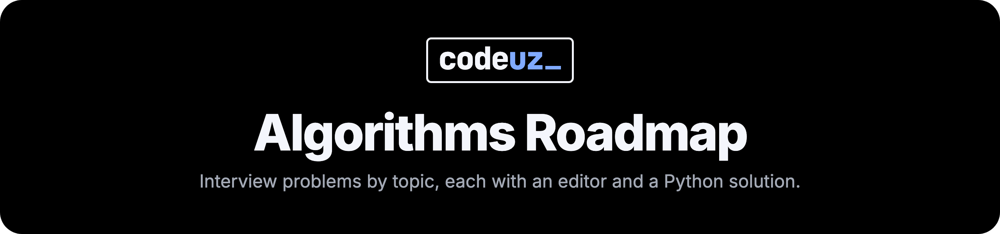

# Algorithms Roadmap

Coding interview problems by topic, following the NeetCode roadmap, with Python solutions that run in the browser. For programming videos in Uzbek, see the [codeuz](https://youtube.com/codeuz) YouTube channel.

**[Open the site](https://codeuz-edu.github.io/algorithms-roadmap/)**

It has 137 problems in 16 topics. Each one has a short statement, an editor with a Check button, and a solution with its time and space cost.

## Run locally

Requires Node.js 22+.

```sh
npm ci
npm run dev
```

## Add a problem

1. Add the problem to its topic in `docs/.vitepress/roadmap.json` with its LeetCode `slug`, `title`, `difficulty` and `number`.
2. Add `docs/problems/<topic folder>/<number>-<slug>.md`, for example `docs/problems/02-two-pointers/0015-3sum.md`. Copy an existing page for the layout: a starter block, then a `Solution` block.
3. Run `python scripts/check.py`. It runs every code block and checks that all solutions on a page print the same output.

## License

[MIT](LICENSE)
